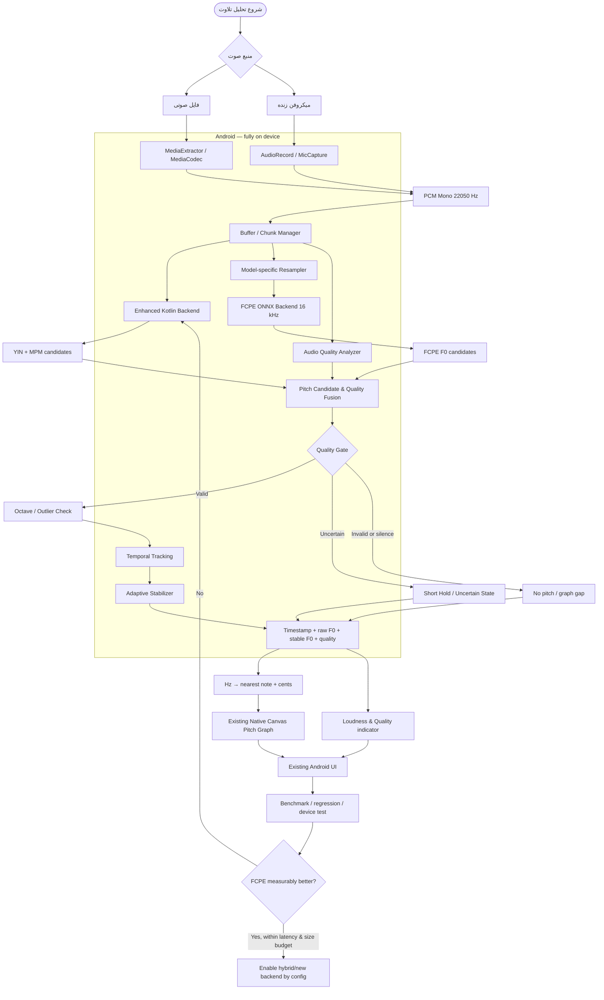

# برنامه پیاده‌سازی موتور تحلیل Pitch تلاوت — Android V1

- وضعیت: برنامه اجرایی برای برنچ مستقل
- برنچ: `feature/android-quran-pitch-engine-v1`
- برنچ مبنا: `Android`
- مخزن: `mahdi-talebian/Ai`
- مسیر برنامه: `android-qari/`
- بسته فعلی: `ir.hamyareqari.app`
- نسخه مبنا در زمان ایجاد برنچ: `1.1.6 / versionCode 8`
- دامنه این سند: فایل صوتی + میکروفن زنده، پردازش روی Android، منحنی پیوسته F0 و نام نت

---

## 1. هدف محصول

ساخت یک موتور تحلیل زیر و بمی صدای قاری (Pitch / F0 Tracking) که:

1. فایل صوتی را تحلیل کند.
2. صدای میکروفن را به‌صورت زنده تحلیل کند.
3. روی خود گوشی و بدون اتصال اینترنت اجرا شود.
4. تغییرات واقعی زیر و بمی و تحریر را حفظ کند.
5. از تبدیل نویز، تشویق، ضربه، سکوت یا خطای تخمین‌گر به جهش جعلی در نمودار جلوگیری کند.
6. شدت صدا (Loudness) را از فرکانس پایه (F0) جدا نگه دارد.
7. F0 خام/پیوسته را حفظ کند و فقط در لایه نمایش، نزدیک‌ترین نام نت و اختلاف سنت را محاسبه کند.
8. موتور فعلی را تا زمان اثبات برتری نسخه جدید، سالم و قابل انتخاب نگه دارد.

**خارج از دامنه V1:** تشخیص مقام‌های قرآنی (بیات، حجاز، صبا و...)، تحلیل تجوید، تشخیص هویت قاری و جداسازی کامل صدای قاری از جمعیت. این موارد بعد از تثبیت Pitch در فازهای بعد بررسی می‌شوند.

## 2. وضعیت موجود مخزن — قبل از هر تغییری بخوان

این مخزن یک اپ بومی Kotlin است؛ طبق README و اسکریپت ساخت فعلی:

- پروژه در `android-qari/` قرار دارد.
- ساخت APK با `android-qari/build_apk.sh` و toolchain سفارشی انجام می‌شود؛ در وضعیت فعلی مهاجرت Gradle انجام نشده است.
- رابط فعلی مبتنی بر Viewهای بومی و Canvas است؛ از جمله `MainActivity.kt` و `ChartView.kt`. مهاجرت به Jetpack Compose در دامنه این کار نیست.
- ورودی فایل از `MediaExtractor / MediaCodec` در `AudioIo.kt` می‌آید.
- میکروفن زنده از `AudioRecord` و `AudioIo.MicCapture` استفاده می‌کند.
- نرخ مشترک فعلی برنامه `AudioIo.TARGET_RATE = 22050` Hz است.
- هسته DSP مستقل از Android در `src/ir/hamyareqari/dsp/` قرار دارد.
- موتور موجود `Analyzer` مسیر `Engine.ENHANCED` (تخمین‌گرهای YIN + MPM، کیفیت فریم، ردیابی نامزدها و اصلاح پرش‌ها) و مسیر `Engine.LEGACY` را نگه می‌دارد.
- `PitchEngine.kt`، `DualEstimator.kt`، `Yin.kt`، `Harmonics.kt`، `Segment.kt` و `Denoise.kt` بخش‌های فعلی DSP هستند.
- مسیر زنده داخل `MainActivity.kt` در کلاس داخلی `LiveEngine` فعلاً از `YinTracker`، `Harmonics.quickOctaveFix` و حلقه دوره‌ای استفاده می‌کند.
- قراردادهای `Report`، `PitchCurve`، خروجی JSON، نمودارهای فعلی، پخش‌کننده، ضبط‌ها، خروجی PNG/MP4 و تست‌های موجود باید حفظ شوند.

### قانون محافظت

قبل از تغییر، وضعیت Git، HEAD، فایل‌های تغییرکرده و اسکریپت‌های تست را ثبت کن. فقط روی همین برنچ کار کن. برنچ `Android`، `main`، APKهای تحویلی قبلی، کلید امضا و تاریخچه Git را تغییر نده. هیچ force-push، reset مخرب، حذف قابلیت یا بازنویسی سراسری انجام نده.

## 3. تصمیم معماری

### 3.1 راهبرد موتور

موتور فعلی `ENHANCED` را baseline و مسیر امن نگه دار. FCPE را ابتدا به‌صورت backend آزمایشی و قابل خاموش‌کردن اضافه کن؛ نه جایگزین فوری موتور فعلی.

قرارداد پیشنهادی:

- `PitchEstimator` یا نام معادل: رابط مشترک برای تخمین‌گرها.
- `EnhancedKotlinPitchBackend`: آداپتر روی موتور فعلی YIN + MPM.
- `FcpeOnnxPitchBackend`: اجرای مدل FCPE با ONNX Runtime، فقط در صورت تأیید مدل و بسته‌بندی.
- `PitchBackendSelector`: انتخاب backend با تنظیمات داخلی/آزمایشی.
- در صورت اثبات بهبود، `HybridPitchBackend` می‌تواند با شواهد مستقل تصمیم بگیرد؛ میانگین‌گیری کورکورانه از دو F0 ممنوع است.

مقادیر پیش‌فرض انتشار تا عبور از معیارهای پذیرش:
`ENHANCED` فعلی. FCPE تا آن زمان opt-in / experimental بماند و در صورت شکست بارگذاری مدل یا inference، برنامه به مسیر فعلی برگردد.

### 3.2 FCPE و ONNX

FCPE یک تخمین‌گر تک‌صدایی F0 است و قرار نیست به‌تنهایی تشخیص دهد منبع صدا قاری است یا تشویق. مدل FCPE در مقاله روی مجموعه‌هایی مثل MIR-1K ارزیابی شده؛ این نتیجه اثبات دقت آن روی تلاوت قرآن نیست.

برای یک ONNX export عمومی که در جامعه منتشر شده، قرارداد گزارش‌شده چنین است:

- ورودی: `float32 [1, n_samples, 1]`
- نرخ ورودی: `16000 Hz`
- گام خروجی: `160 samples = 10 ms`
- خروجی: `float32 [1, n_frames, 1]` برحسب Hz
- `0` یعنی unvoiced؛ خروجی ممکن است در برخی حالت‌ها NaN باشد و باید رد شود.
- خروجی F0 این export لزوماً confidence پیوسته و کالیبره‌شده در اختیار برنامه نمی‌گذارد.

این قرارداد را با مدل واقعی و نسخه واقعی فایل ONNX تأیید کن؛ به توضیح README یک mirror اکتفا نکن. منبع اصلی کد/وزن‌ها، مجوز، hash، اندازه، شکل ورودی/خروجی و سازگاری opset را در گزارش ثبت کن. export جامعه را رسمی یا تأییدشده از طرف نویسندگان معرفی نکن.

**مهم:** نرخ 22050 فعلی برنامه را سراسری تغییر نده. سیگنال اصلی و موتور موجود در قالب فعلی باقی بماند. فقط یک مسیر resampling مستقل و باکیفیت از 22050 (یا نرخ PCM منبع) به 16000 برای FCPE بساز. Resampling باید ضد-aliasing باشد؛ interpolation خطی فعلی `StreamResampler` را بدون اندازه‌گیری برای مدل عصبی مناسب فرض نکن.

### 3.3 ONNX Runtime در ساختار فعلی پروژه

پروژه Gradle ندارد و build script مستقیماً Kotlin را کامپایل و APK را بسته‌بندی می‌کند. بنابراین افزودن `onnxruntime-android` صرفاً با نوشتن یک dependency در فایل فرضی کافی نیست.

ابتدا یک integration spike کوچک بساز و ثابت کن که:
1. نسخه مشخص `onnxruntime-android` از Maven دریافت و pin می‌شود.
2. کلاس‌های AAR در compile classpath و D8 قرار می‌گیرند.
3. کتابخانه‌های native لازم برای ABIهای هدف داخل APK بسته‌بندی می‌شوند.
4. ONNX Session روی دستگاه Android واقعی ساخته می‌شود.
5. CPU fallback کار می‌کند؛ XNNPACK فقط در صورت پشتیبانی مدل و بهبود اندازه‌گیری‌شده فعال شود.
6. مجوز `INTERNET` برای runtime اضافه نشود؛ دانلود مدل در زمان اجرای اپ ممنوع است.

نسخه Runtime، URL منبع، checksum و ABIهای بسته‌بندی‌شده را مستند کن. اندازه APK و حافظه را اندازه بگیر. از اضافه کردن بی‌دلیل تمام ABIها و کتابخانه‌های native خودداری کن. تنظیم threadها را طوری انجام بده که thread pool داخلی ONNX و threadهای برنامه روی هم نیفتند.

اگر ادغام ONNX در build فعلی بدون تغییر معماری ساخت ممکن نیست، مشکل را شفاف گزارش کن؛ به‌جای ساخت stub یا خروجی جعلی FCPE، مسیر فعلی را سالم نگه دار و یک تصمیم فنی مستند ارائه کن.

### 3.4 مسیر فایل و زنده

هر دو ورودی باید در سطح domain به قرارداد داده یکسان برسند، اما نباید برای تحلیل زنده روی هر callback مدل سنگین اجرا شود.

**فایل:**
- مسیر decode فعلی `AudioIo.decode` و `MediaCodec` را حفظ کن.
- پس از decode، داده را به backend انتخاب‌شده بده.
- برای فایل‌های طولانی پردازش chunk-based با overlap و مرزهای پیوسته داشته باش؛ از کپی چندباره کل فایل در حافظه جلوگیری کن.
- timestamp خروجی باید به زمان اصلی فایل نگاشت شود.

**میکروفن زنده:**
- `AudioIo.MicCapture` و مدیریت permission فعلی را حفظ کن.
- callback ضبط فقط داده را به بافر امن/کم‌هزینه منتقل کند؛ اجرای ONNX، FFT و رسم نمودار در callback ممنوع.
- inference در worker مستقل با پنجره و overlap انجام شود.
- طول پنجره و hop را از قرارداد مدل واقعی بگیر و تأخیر end-to-end را اندازه بگیر؛ ادعای 100 FPS بدون خروجی و زمان‌بندی واقعی نکن.
- مسیر فعلی live در `MainActivity.LiveEngine` را به‌صورت حداقلی به backend selector متصل کن؛ MainActivity را بازنویسی نکن.

### 3.5 کیفیت، فریم نامعتبر و نمودار

یک quality gate چندشاهدی بساز/تکمیل کن. از یک RMS ثابت به‌عنوان تنها معیار استفاده نکن.

شواهد قابل استفاده:
- voicing / periodicity و clarity تخمین‌گر،
- توافق یا اختلاف YIN/MPM/FCPE،
- انرژی نسبت به کف نویز محلی،
- spectral flatness و harmonic support،
- clipping و spectral flux،
- پیوستگی زمانی و نامزدهای جایگزین،
- شرایط سکوت یا نبود صدای قابل اعتماد.

خروجی داخلی confidence را کالیبره کن؛ اگر مدل FCPE فقط F0 گیت‌شده برمی‌گرداند، آن را confidence رسمی مدل قلمداد نکن. امتیاز ترکیبی برنامه را با نام `qualityScore` یا مشابه مشخص کن.

قواعد:
- Loudness هرگز مستقیماً Pitch curve را بالا/پایین نبرد.
- جهش اکتاو تک‌فریمی که با شواهد دیگر پشتیبانی نمی‌شود، به‌عنوان outlier بررسی شود.
- تغییر واقعی نت یا تحریر سریع حذف نشود.
- Median filter کوتاه و smoothing تطبیقی باشد؛ فیلتر سنگین و ثابت ممنوع.
- شکاف کوتاه فقط با شرایط دوطرفه و وضعیت `ESTIMATED` پر شود.
- بعد از gap طولانی، عدد جعلی یا صفر به‌عنوان نت رسم نشود؛ نقطه نامعتبر به شکاف/عدم‌تشخیص تبدیل شود.
- نگهداری آخرین نت معتبر فقط کوتاه و با نمایش بصری متفاوت انجام شود؛ برای همیشه ادامه پیدا نکند.
- داده خام و داده تثبیت‌شده جدا ذخیره شوند تا امکان audit و مقایسه باقی بماند.

ساختار پیشنهادی هر نمونه:
`timestampSec, rawF0Hz, stableF0Hz, noteMidi, cents, qualityScore, loudnessRms, status, backend`.

نام نت فقط لایه نمایشی باشد؛ مقدار دقیق Hz و Cent از بین نرود. محور نمودار برای مقایسه فرکانس‌ها بهتر است log/cent باشد و پیاده‌سازی فعلی نمودار با حداقل تغییر ارتقا یابد.

## 4. دیاگرام معماری Mermaid

## 5. مراحل پیاده‌سازی

### فاز 0 — بازبینی و baseline

- روی برنچ فعلی، git status و HEAD را ثبت کن.
- README، build script، `Analyzer`، `PitchEngine`، `DualEstimator`، `Yin`، `AudioIo`، `MainActivity.LiveEngine`، `ChartView` و تست‌ها را کامل بخوان.
- تست‌های موجود را بدون تغییر اجرا کن و نتیجه را به‌عنوان baseline ذخیره کن.
- نسخه موجود APK را با تغییرات جدید overwrite نکن.

### فاز 1 — قرارداد مشترک و تست داده

- interface backend و data class نمونه Pitch را اضافه کن.
- آداپتر baseline را به موتور ENHANCED موجود وصل کن؛ خروجی و JSON نباید تغییر ناسازگار کنند.
- تست واحد برای زمان‌بندی، Hz/Cent، وضعیت‌ها، NaN/Infinity و gapها بنویس.

### فاز 2 — FCPE integration spike

- مدل و مجوز و provenance را بررسی کن.
- فایل ONNX و I/O را با ابزار مستقل و نسخه PyTorch مرجع cross-check کن.
- dependency و native packaging ONNX Runtime را با APK کوچک آزمایش کن.
- زمان بارگذاری مدل، زمان inference، RAM و اندازه APK را روی دستگاه واقعی ثبت کن.
- در این مرحله هنوز FCPE را default نکن.

### فاز 3 — FCPE backend و hybrid validation

- resampler مخصوص مدل را اضافه کن.
- inference فایل chunked و inference زنده با worker/overlap پیاده‌سازی شود.
- FCPE را با YIN/MPM و quality analyzer مقایسه کن.
- تصمیم fusion باید candidate-based و quality-aware باشد؛ میانگین ساده F0 ممنوع.

### فاز 4 — اتصال به UI موجود

- مسیر تحلیل فایل و live را به backend selector وصل کن.
- نمودار پیوسته فعلی، نام نت، مقدار Hz، اختلاف سنت و status/quality را حفظ و در صورت نیاز تکمیل کن.
- هیچ قابلیت فعلی حذف یا پنهان نشود.
- وضعیت‌های invalid/uncertain/estimated روی نمودار از هم قابل تشخیص باشند.

### فاز 5 — تست و بهینه‌سازی

- تمام تست‌های فعلی را اجرا کن.
- تست‌های جدید را روی تلاوت واقعی، فایل آرام/بلند، gain متفاوت، نویز ثابت/متغیر، تشویق، همهمه چندنفره، سکوت، کلیپینگ، تغییر سریع نت و تحریر اضافه کن.
- مجموعه تلاوت واقعی باید با annotation انسانی/ابزار مرجع کنترل شود؛ داده مصنوعی به‌تنهایی برای ادعای کیفیت کافی نیست.
- معیارها: median و P95 خطای Cent، Gross Pitch Error، octave error، false acceptance در سکوت/تشویق، false rejection روی تلاوت، حفظ دامنه تحریر، end-to-end latency P50/P95، CPU، RAM، اندازه APK و مصرف باتری.
- FCPE را تنها زمانی default کن که روی داده تلاوت واقعی بهبود معنادار داشته باشد و latency/size/thermal را نقض نکند.

### فاز 6 — APK و تحویل

- build APK با اسکریپت رسمی مخزن انجام شود.
- APK جدید با نام خروجی تازه ساخته شود؛ فایل‌های release قبلی overwrite نشوند.
- امضا و applicationId سازگار بماند؛ هیچ کلید یا رمز امضا را در log، گزارش یا commit چاپ نکن.
- نصب/اجرای واقعی روی Android را در صورت دسترسی تست کن. اگر دستگاه/ADB در دسترس نیست، این محدودیت را دقیق گزارش کن.
- گزارش نهایی شامل commit SHA، فایل‌های تغییرکرده، تست‌های اجراشده و ردشده، اطلاعات APK (نام/حجم/versionCode)، نتایج benchmark و محدودیت‌های باقیمانده باشد.

## 6. معیارهای پذیرش

کار فقط زمانی آماده تحویل است که:

1. برنچ `Android` و `main` بدون تغییر مانده باشند.
2. مسیر قدیمی `Engine.LEGACY` و موتور فعلی `Engine.ENHANCED` قابل اجرا باشند.
3. تحلیل فایل و میکروفن زنده هر دو کار کنند.
4. برنامه در زمان اجرا هیچ وابستگی شبکه‌ای یا دانلود مدل نداشته باشد.
5. FCPE فقط در صورت بارگذاری موفق فعال شود و fallback واقعی داشته باشد.
6. بلندی صدا به‌تنهایی باعث تغییر F0 نشود.
7. نویز/تشویقِ نامعتبر به جهش جعلی در نمودار تبدیل نشود.
8. تحریر و تغییر واقعی Pitch بی‌دلیل صاف یا حذف نشود.
9. JSON و قابلیت‌های قبلی پس‌سازگار باشند.
10. تست‌های قبلی و جدید سبز باشند یا تمام شکست‌ها با علت مستند شوند.
11. APK تازه ساخته شود و APKهای قبلی دست‌نخورده بمانند.
12. نتیجه با داده واقعی تلاوت گزارش شود؛ هیچ دقتی بدون اندازه‌گیری ادعا نشود.

## 7. قواعد کاری ایجنت

- ابتدا onboard کامل روی برنچ و کد موجود؛ سپس تغییر.
- فقط همین برنچ را checkout و تغییر بده.
- هر فاز را در commit کوچک و قابل بازگشت ثبت کن.
- قبل از افزودن dependency، اثر آن بر build سفارشی را اثبات کن.
- هیچ API، کلاس، فایل یا تست موجود را بدون دلیل حذف نکن.
- تست‌ها را برای سبز شدن مصنوعی ضعیف نکن.
- خطاهای واقعی را پنهان نکن؛ fallback، unsupported و not-tested را واضح گزارش کن.
- اگر منبع مدل یا سازگاری ONNX قابل تأیید نبود، FCPE را با داده ساختگی شبیه‌سازی نکن و موتور فعلی را سالم نگه دار.
- در پایان، فقط ادعای کارهای واقعاً انجام‌شده و تست‌هایی را که واقعاً اجرا شده‌اند مطرح کن.

## 8. منابع فنی برای بررسی

- FCPE upstream: https://github.com/CNChTu/FCPE
- مقاله FCPE: https://arxiv.org/abs/2509.15140
- مستندات ONNX Runtime Mobile: https://onnxruntime.ai/docs/tutorials/mobile/
- XNNPACK Execution Provider: https://onnxruntime.ai/docs/execution-providers/Xnnpack-ExecutionProvider.html
- Android AudioRecord: https://developer.android.com/reference/android/media/AudioRecord
- Android MediaCodec: https://developer.android.com/reference/android/media/MediaCodec

این منابع نقطه شروع بررسی هستند؛ نسخه‌ها، مجوزها، قرارداد مدل و سازگاری واقعی باید در زمان پیاده‌سازی مجدداً تأیید شوند.
